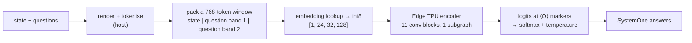

<p align="center">
  <picture>
    <source media="(prefers-color-scheme: dark)" srcset="docs/banner.dark.svg">
    
  </picture>
</p>

**Give your retired Coral a new job.** Reef runs a small, calibrated *decision model* entirely on a
Google Coral Edge TPU. You send it a state (an alert, a Frigate event, a support ticket, a
transcript, any JSON or text) and a few typed questions. It returns a probability for every
option, on your LAN, at about 2 W.

```bash
curl -s reef.lan:8080/v1/systemone -d '{
  "state": {"source": "alertmanager", "labels": {"alertname": "ZfsPoolDegraded", "instance": "nas01"},
            "annotations": {"description": "1 device FAULTED in mirror-0"}, "context": {"local_time": "Sun 03:12"}},
  "questions": {
    "wake_me":  {"type": "noul",   "instructions": "Is this worth waking someone up at night?"},
    "severity": {"type": "score",  "instructions": "How urgent is this?",
                 "criteria": ["ignore", "this week", "today", "within the hour", "drop everything"]},
    "category": {"type": "choice", "instructions": "What kind of problem is this?",
                 "criteria": {"storage": "disks, pools", "network": "connectivity", "service": "apps"}}
  }}'
```

The request and response use the same `POST /v1/systemone` shape as TypeSafe Jev and Laya,
so existing clients work after a base-URL change. Each answer has a full probability
distribution, a `confidence` value and, for scores, an expected value. Answer cheap, frequent
decisions locally, and send the low-confidence ones to a big model.

## Results: Decision Index 0.2.1

[Decision Index](https://huggingface.co/spaces/multimodalart/jev-decision-index) scores typed
decision models on 38 public benchmarks in five areas (knowledge, language, retrieval, tools,
arts), each chance-corrected, so 0 means random guessing. We ran the public harness
([apolinario/decision-index](https://github.com/apolinario/decision-index)) on the full local
suite: 150,246 requests, served from the int8 model.

| Model | Params (total) | Index |
|---|---|---|
| **[Reef](https://huggingface.co/seraphimserapis/reef), int8, fully on the Edge TPU** | **11.2M** | **4.73** |
| GLiNER 2.5 small ([fastino/gliner2.5-small-v1](https://huggingface.co/fastino/gliner2.5-small-v1)) | 73.9M | 3.82 |
| Reef v1 (homelab specialist) | 10.3M | 2.38 |

Read the Reef number with these caveats:

- **Not an official entry.** It is self-measured, not a leaderboard submission. The other rows are the published board scores.
- **Serving mode.** Measured in the server's default (lenient) mode, which truncates over-long inputs instead of refusing them. `--strict` costs about 0.15–0.2.
- **Lower bound.** HLE has no rows in the local suite and counts as 0.
- **Run-to-run variance.** Retraining moved single benchmarks by up to ±0.1 skill, so treat ±0.3 Index points between checkpoints as noise.
- **Params.** The count includes the host's token table (3.8M frozen [potion-base-8M](https://huggingface.co/minishlab/potion-base-8M) vectors). The 7.4M-parameter encoder runs on the Edge TPU, and all neural-network compute happens there.

**Where it is good:** intent detection (BANKING77 with all 77 options, CLINC150+OOS with 151),
When2Call, FinEntity, phishing triage, ContractNLI.

**Where it isn't:** it sits at chance on tool retrieval and selection (BFCL, ToolRet), BRIGHT,
HoVer, ANLI, Amazon ESCI and the knowledge and reasoning benchmarks (MMLU-Pro, BBH, GSM8K). An 11M
model trained from scratch has little world knowledge.

**Shortcuts deliberately not used.** We did not rank documents by the harness's BM25 order, and
we did not decode BFCL as "exactly one tool". Both add Index points without any model skill.
Training data comes only from train splits, deduplicated against the suite's test inputs.

## On your Coral

Held-out tests, same int8 model on a Coral USB Accelerator:

| Test set | Accuracy | KL ↓ |
|---|---|---|
| Homelab packs (5 packs, Gemma 4 soft labels) | 0.807 | 0.212 |
| Answer-audit (judging what an agent claims it did) | 0.705 | 0.634 |
| [typed-decisions](https://huggingface.co/datasets/LocalLLaMA/typed-decisions) test | 0.535 | 0.294 |
| [Open-Jev](https://huggingface.co/datasets/ZefanCai/Open-Jev) out-of-distribution | 0.695 | 0.610 |

The int8 model stays within about 1–2 accuracy points of the float model thanks to
quantisation-aware fine-tuning (see [docs/edge-tpu-notes.md](docs/edge-tpu-notes.md)).

## Why

- **Coral owners have one in a drawer.** Many homelabs bought a Coral for Frigate, then moved
  detection to OpenVINO or Hailo. A Coral is 4 TOPS of int8 compute that is otherwise idle.
- **Decisions, not chat.** Most automation "AI" questions are narrow and repetitive: is this
  alert real, should this notification wake me, which intent is this, did the agent claim it
  paid. A model with a few million parameters answers these fast with honest probabilities. It
  never generates text, so there is nothing to parse and nothing to hallucinate.
- **It runs locally and is open.** Apache-2.0 code and weights, a TensorFlow-free runtime (numpy +
  tokenizers + LiteRT) and a Docker image for amd64 and arm64.

## Packs

A pack is a homelab domain with question sets, a realistic state generator and integration
examples. The model was trained on all of them, alongside public decision data. The questions are
part of the input, so you can reword them or ask new ones.

| Pack | State | Example questions |
|---|---|---|
| `alert-triage` | Alertmanager, Uptime Kuma, syslog | actionable? · severity · category · wake me? · data at risk? |
| `frigate-triage` | Frigate event metadata + household context (no images: Frigate already did the vision) | notify? · threat level · action · category · false positive? |
| `notify-gate` | Home Assistant notification + time, presence, sleep mode | channel (drop / digest / push / critical) · wake up? · urgency · safety? |
| `protect-triage` | UniFi Protect events: smart detections, faces, plates, audio (smoke, CO, glass break, chatter), doorbell, camera health | notify? · urgency · action · category · emergency? |
| `unifi-network` | UniFi Network events: WAN failover, ISP latency, APs offline, port flaps, IPS hits, admin logins, rogue APs | notify? · severity · ignore / log / digest / notify / page · security-relevant? |

`reef packs` lists them, and `reef packs alert-triage` prints the canonical questions. Pack states
are synthetic. Their training labels are answer distributions from **Gemma 4** (E4B and 26B-A4B),
read from option-token logprobs.

## Speed, honestly

| | per window (768 tokens) |
|---|---|
| Coral USB Accelerator (USB 2 link) | ≈ 32 ms |
| Apple M-series CPU, int8, 1 thread, idle machine | ≈ 6.5 ms |

Most requests take one window. Long states and questions with many options take more (BANKING77's
77 intents take 7, CLINC150's 151 take 13). On a fast desktop CPU, the Coral is about offloading work and power, not
raw speed. On the hosts homelabs actually run (Raspberry Pi, N100 mini PCs, a NAS), it frees the
CPU for everything else. `reef bench` measures both on your hardware. The whole encoder runs on
the Edge TPU as one subgraph that fits in its on-chip SRAM (7.36 MiB, 0 B streamed). See
[docs/edge-tpu-notes.md](docs/edge-tpu-notes.md) for how, and for the dead ends.

## Quickstart

```bash
pip install "reef-decide @ git+https://github.com/SeraphimSerapis/reef"
reef setup-edgetpu      # macOS: downloads + patches libedgetpu; Linux: tells you which .deb to install
reef doctor             # finds the Coral, checks the USB link
reef serve --host 0.0.0.0   # fetches seraphimserapis/reef from Hugging Face on first run
```

Models live on the Hugging Face Hub at [huggingface.co/seraphimserapis](https://huggingface.co/seraphimserapis).
Any command that takes a model takes a repo id (`org/name[@revision]`) or a local directory, and
`reef pull seraphimserapis/reef ./models/reef` gets a copy you can run offline.

Or with Docker, alongside the rest of your stack ([examples/docker-compose.yml](examples/docker-compose.yml)):

```bash
docker run -d --name reef -p 8080:8080 --device /dev/bus/usb \
  -v reef-data:/data ghcr.io/seraphimserapis/reef        # REEF_MODEL picks the model, default seraphimserapis/reef
```

> [!IMPORTANT]
> An Edge TPU can only be opened by one process at a time. If Frigate uses your Coral, give Reef
> a second one, or the second TPU of a dual-TPU M.2 card.

Integrations: [Home Assistant + Frigate automation](examples/home-assistant.yaml). Anything that
can POST JSON works too: Node-RED, n8n, Alertmanager webhooks.

## Make your own

```bash
# 1. label generated states with any OpenAI-compatible server that returns logprobs
#    (llama.cpp, Ollama, MLX-LM, vLLM), or any /v1/systemone endpoint
reef label alert-triage --teacher http://gpu-box:8080 --model gemma4 --n 5000 --out-dir data

# 2. fine-tune from the released model (or train from scratch), quantise, compile, evaluate
reef train --init seraphimserapis/reef --data data/alert-triage.jsonl --test data-test/alert-triage.jsonl --out runs/mine
reef export runs/mine artifacts/mine        # edgetpu_compiler runs in Docker if not installed
reef eval artifacts/mine --device edgetpu

# 3. share it: uploads the runtime files plus a generated model card with your eval results
reef push artifacts/mine yourname/reef-mine --teacher "Gemma 4 E4B"
```

Check the licence of any teacher you distil from before publishing the result.

## How it works



- **Joint schema.** Every option is a marker token in the window, and the model emits one logit
  per marker, as in Clef and Laya. New questions need no new heads. Questions with many options
  are answered as a knockout over parts, and long states are read in overlapping windows.
- **Text as an image.** The Edge TPU is built for convolutions over images, so the 768-token window
  is folded into a 24 × 32 grid.
- **Summaries instead of attention.** The Edge TPU compiler cannot run attention. Each block mixes
  information with a 3 × 5 depthwise convolution, a mean+max summary of the state broadcast to
  every position, and a summary per question band. A multiplicative gate lets an option's
  features be matched against its question and the state in one product.
- **Built for int8.** Leaky MLPs (as `max(x, 0.1x)`, which the compiler maps), BatchNorm folded
  into the next conv at export, and quantisation-aware fine-tuning with activation clips that
  become the int8 ranges.
- **Pre-training, then fine-tuning.** The model is pre-trained on about 300k public decision cases
  (intents, NLI, tool use, sentiment, retrieval; train splits, permissive licences), then fine-tuned
  with the homelab packs, an answer-audit pack and typed-decision benchmarks. The loss is
  cross-entropy against the full label distribution, with per-type temperature scaling fitted on
  held-out data.

## Credits

- Teacher models for the packs: [Gemma 4](https://huggingface.co/google/gemma-4-E4B-it) E4B and 26B-A4B (Apache-2.0).
- Static embeddings and tokenizer: [potion-base-8M](https://huggingface.co/minishlab/potion-base-8M) (MIT).
- Benchmarks and harness: [Decision Index](https://github.com/apolinario/decision-index) (MIT; the public-data request wording mirrors its adapters),
  [LocalLLaMA/typed-decisions](https://huggingface.co/datasets/LocalLLaMA/typed-decisions) (Apache-2.0),
  [ZefanCai/Open-Jev](https://huggingface.co/datasets/ZefanCai/Open-Jev) (CC0).
- Public training data, train splits only:
  - intents: MASSIVE, SNIPS, BANKING77, CLINC150, MINDS-14;
  - NLI: WANLI, MultiNLI (OANC genres), ContractNLI;
  - tools: Glaive function calling, ToolACE, When2Call, API-Bank;
  - retrieval: Amazon ESCI;
  - sentiment, finance and toxicity: GoEmotions, Civil Comments, SMS Spam, SEntFiN, Twitter financial news, iSarcasmEval;
  - commonsense: HellaSwag, WinoGrande, GSM8K.

  The licences are CC BY 4.0/3.0, CC0, Apache-2.0 and MIT. See the
  [model card](https://huggingface.co/seraphimserapis/reef) for details.
- Edge TPU runtime: [feranick/libedgetpu](https://github.com/feranick/libedgetpu), compiler:
  [google-coral/edgetpu](https://github.com/google-coral/edgetpu).
- Inspiration: TypeSafe Jev, [Cloudflare Clef](https://huggingface.co/Cloudflare/clef-flash) and
  [Laya](https://huggingface.co/convaiinnovations/laya), whose `/v1/systemone` shape Reef speaks.

Apache-2.0. See [LICENSE](LICENSE) and [NOTICE](NOTICE).
